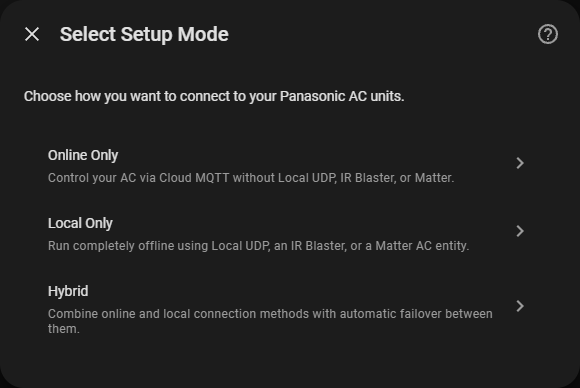
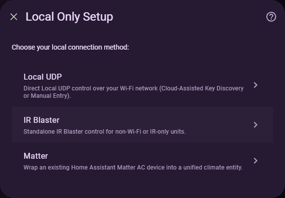
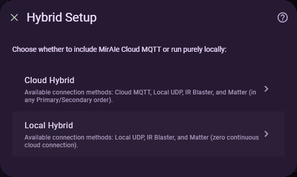
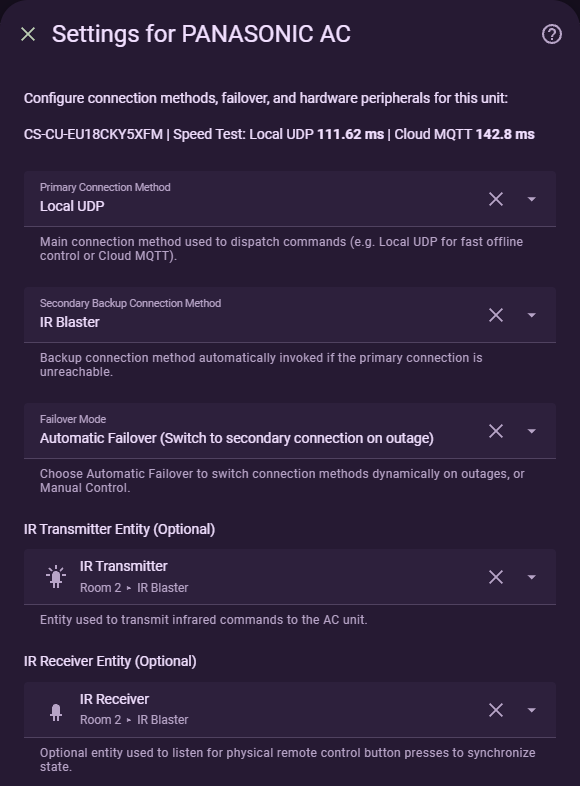
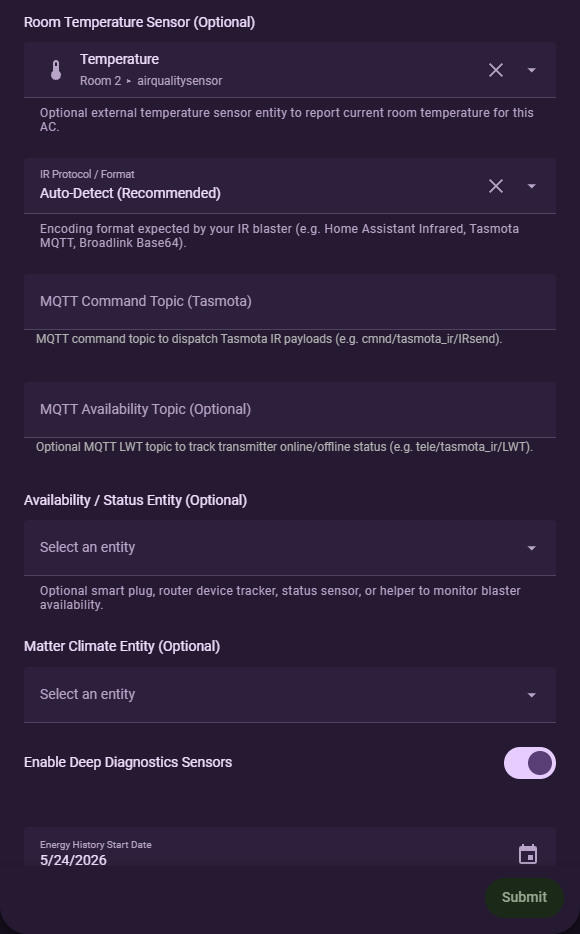

# What's New in Panasonic AC India 3.0 (Beta)

> [!NOTE]
> For full 3.0 Beta setup, configuration, and troubleshooting instructions, see the **[Panasonic AC India 3.0 Beta README](README-3.0.md)**.

Panasonic AC India `3.0` brings **Matter AC support**, **100% offline Hybrid modes**, **real-time blended energy estimation**, and **deep inverter diagnostics**—while keeping all existing climate entities, automations, and energy history intact on upgrade.

---

## 1. Streamlined 3-Level Connection Setup

The integration setup wizard now organizes all **connection methods** into three clear paths:

| Setup Path | Available Connection Methods |
| :--- | :--- |
| **Online Only** | `Cloud MQTT` (MirAIe cloud login or `demo@miraie.in` demo mode) |
| **Local Only** | `Local UDP`, `IR Blaster`, `Matter`, or any offline combination (`Local UDP + IR`, `Matter + IR`, `Matter + Local UDP`) |
| **Hybrid** | Connect both **online** (`Cloud MQTT`) and **local** (`Local UDP`, `IR Blaster`, `Matter`) connection methods with automatic failover |

| Main Setup Menu | Local Only Setup | Hybrid Setup |
| :---: | :---: | :---: |
|  |  |  |

> [!NOTE]
> Use **Configure** on any device card at any time to switch primary/secondary/tertiary connection methods, enable `Auto Failover`, or add an IR blaster, Local UDP, or Matter link.

---

## 2. Matter AC Support & Hybrid Delegation

Panasonic ACs paired over **Matter** can now be bridged directly into your Panasonic AC India device:

* **Standalone Matter-Only Mode**: Control temperature (`16–30 °C`), HVAC modes, and fan speed locally with zero cloud login. Unsupported cloud/UDP-only features (such as Nanoe™, Display, and Coil Clean) are cleanly hidden or greyed out in the companion card.
* **Packed-Temperature & Bounds Normalization**: Automatically decodes Matter packed ambient temperatures (e.g. `61.3` → `30.24 °C`) and enforces `16–30 °C` setpoint limits.
* **Capability-Based Hybrid Delegation**: Pair `Matter` with `Local UDP`, `IR Blaster`, or `Cloud MQTT` so standard setpoint and mode changes run over Matter while advanced features route through your secondary connection method.

---

## 3. Blended Energy & `/diag` Inverter Telemetry

* **Blended Today Energy (`sensor.<device>_energy_today`)**: Combines live inverter power estimation (using the 508-model BEE database in `panasonic-ac-models`) with official MirAIe Cloud hourly/daily totals.
* **Deep Inverter Diagnostics (`/diag`)**: When **Enable Deep Diagnostics Sensors** is turned on in Device Settings, the integration decodes live TLV diagnostic payloads:
  * **Compressor Frequency (`Hz`)**
  * **Evaporator Coil Temperature (`°C`)**
  * **Outdoor Condenser Temperature (`°C`)**
  * **Line Voltage (`V`)** and **Compressor Current (`A`)**
* **Local UDP Heartbeat**: Periodic UDP keepalive keeps `Local UDP Connected` accurate even when the AC is idle.

| Connection & IR Settings | Peripherals, Matter & Deep Diagnostics |
| :---: | :---: |
|  |  |

---

## 4. Companion Card 3.0 (`panasonic-ac-card-in`)

* **Google Home (Material 3) & Classic UI Styles**: Updated active chip highlights, readable mode dropdowns, and balanced Dark & Light theme support.
* **Live Electrical Footer Pills**: Shows **Voltage (`V`)** and **Current (`A`)** alongside frequency, coil/condenser temperatures, and Wi-Fi RSSI.
* **Custom Visual Editor**: Built-in `ha-form` visual editor auto-populates companion entities when you add the card, while letting you remove or override any sensor individually (including external smart-plug power/energy sensors).

---

## 5. Automated Upgrade from `2.1` to `3.0`

Upgrading from `2.1` to `3.0` is fully automatic:
* Existing config entries migrate cleanly to schema version 4 without losing `climate.*` entity IDs or automations.
* Long-term cumulative energy statistics (`energy_today` / `energy_history`) are preserved across the upgrade.
